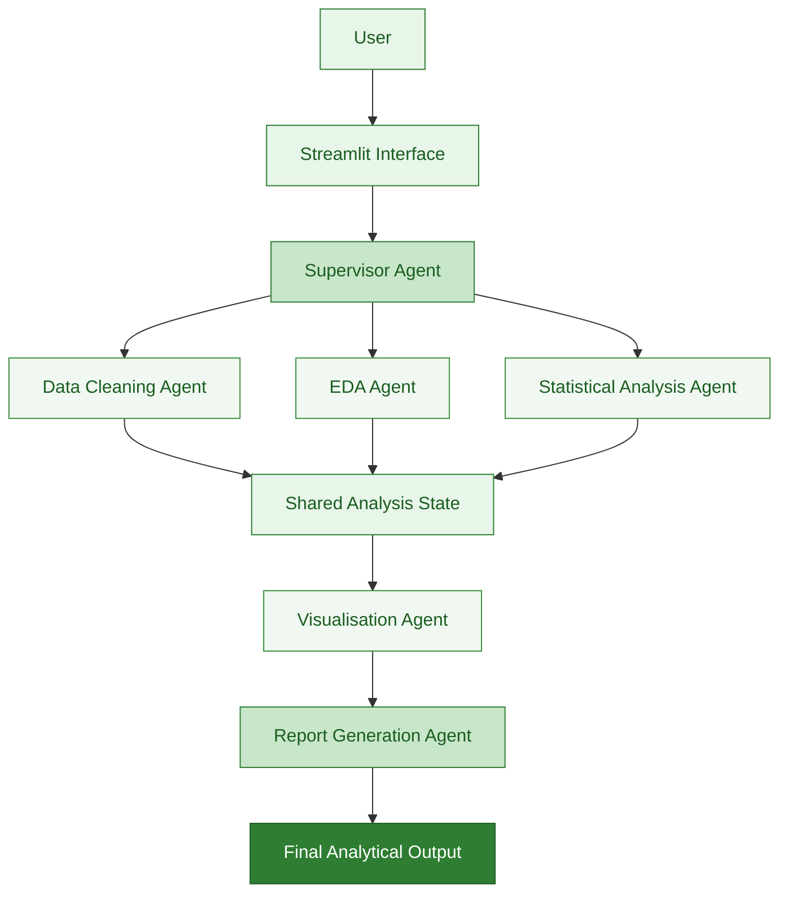

<h1 align="center">AI Data Analyst Agent</h1>

<p align="center">
  <b>An LLM-powered multi-agent system for automated data analysis</b>
</p>

<p align="center">
  
  
  
  
  
  
  
  
  
</p>

---

## Table of Contents

1. [Overview](#1-overview)
2. [Objectives](#2-objectives)
3. [Core Functionalities](#3-core-functionalities)
4. [Multi-Agent Architecture](#4-multi-agent-architecture)
5. [System Architecture](#5-system-architecture)
6. [Technology Stack](#6-technology-stack)
7. [Expected Workflow](#7-expected-workflow)
8. [Project Structure](#8-project-structure)
9. [Installation and Configuration](#9-installation-and-configuration)
10. [Future Scope](#10-future-scope)
11. [Project Status](#11-project-status)
12. [Author](#12-author)

---

## 1. Overview

The **AI Data Analyst Agent** is an LLM-powered multi-agent system that automates the end-to-end data analysis process through natural language interaction.

It combines Large Language Models (LLMs), agent orchestration frameworks and conventional data science libraries to perform analytical tasks with minimal manual effort.

Users upload a structured dataset and ask questions in plain language. Specialised agents then handle:

- Data preprocessing
- Exploratory data analysis
- Statistical analysis
- Visualisation
- Report generation

The project explores how Generative AI and Agentic AI can automate traditional data science workflows.

---

## 2. Objectives

- Build an autonomous multi-agent system for data analysis
- Integrate LLMs with conventional data science workflows
- Automate data preprocessing and exploratory analysis
- Implement intelligent tool selection and execution
- Generate data-driven insights and interactive visualisations
- Design an extensible architecture for AI-assisted analytics

---

## 3. Core Functionalities

| Module | Description |
|---|---|
| **Natural Language Interface** | Accepts analytical queries in plain language |
| **Automated Data Cleaning** | Finds missing values, duplicates and inconsistencies |
| **Exploratory Data Analysis** | Descriptive statistics and data exploration |
| **Statistical Analysis** | Statistical computations and relationship analysis |
| **Data Visualisation** | Interactive charts and graphical output |
| **Trend and Anomaly Detection** | Identifies patterns, trends and outliers |
| **Report Generation** | Structured analytical reports and insights |

---

## 4. Multi-Agent Architecture

The system is orchestrated with **LangGraph**. Each agent has a specialised responsibility, while a central supervisor coordinates execution and information exchange.

### 01. Supervisor Agent
- Interprets user instructions
- Determines the analytical workflow
- Assigns tasks to specialised agents
- Coordinates execution and integrates outputs

### 02. Data Cleaning Agent
- Detects missing values and duplicate records
- Identifies inconsistent data
- Applies appropriate preprocessing techniques
- Validates data quality

### 03. Exploratory Data Analysis Agent
- Examines dataset structure and characteristics
- Computes descriptive statistics
- Identifies distributions and correlations
- Generates exploratory insights

### 04. Statistical Analysis Agent
- Performs statistical computations
- Conducts hypothesis testing where appropriate
- Identifies significant relationships
- Interprets analytical findings

### 05. Visualisation Agent
- Selects suitable visualisation techniques
- Generates interactive charts
- Represents statistical findings graphically
- Produces visual summaries

### 06. Report Generation Agent
- Consolidates analytical outputs
- Summarises findings and observations
- Generates actionable insights
- Produces comprehensive analytical reports

---

## 5. System Architecture



A shared workflow state lets agents communicate with each other. Conditional routing allows the supervisor to run only the analytical modules needed for the user's request.

---

## 6. Technology Stack

| Technology | Purpose |
|---|---|
| **Python** | Core application development |
| **LangGraph** | Agent orchestration and workflow management |
| **LangChain** | LLM integration and tool development |
| **OpenAI API** | Language model integration |
| **Pandas** | Data manipulation and analysis |
| **NumPy** | Numerical computation |
| **Plotly** | Interactive data visualisation |
| **FastAPI** | Backend API development |
| **Streamlit** | Interactive frontend |

---

## 7. Expected Workflow

1. **Data Input**: User uploads a CSV or Excel dataset
2. **Query Processing**: Supervisor interprets the analytical request
3. **Task Allocation**: Relevant agents are selected
4. **Data Processing**: Agents clean and preprocess the data
5. **Analysis**: EDA and statistical analysis are performed
6. **Visualisation**: Suitable charts are generated
7. **Report Generation**: Findings are consolidated into a structured report
8. **Output Delivery**: Results are shown in the application interface

---

## 8. Project Structure

```text
AI-Data-Analyst-Agent/
├── agents/
│   ├── supervisor.py
│   ├── data_cleaning_agent.py
│   ├── eda_agent.py
│   ├── statistical_agent.py
│   ├── visualization_agent.py
│   └── report_agent.py
├── workflows/
│   └── graph.py
├── backend/
│   └── main.py
├── frontend/
│   └── app.py
├── utils/
│   ├── data_loader.py
│   └── helpers.py
├── data/
├── reports/
├── tests/
├── requirements.txt
├── .env.example
├── .gitignore
└── README.md
```

| Path | Purpose |
|---|---|
| `agents/` | Specialised agent modules |
| `workflows/` | LangGraph workflow definition |
| `backend/` | FastAPI backend |
| `frontend/` | Streamlit interface |
| `utils/` | Data loading and helper functions |
| `data/` | Uploaded datasets |
| `reports/` | Generated reports |
| `tests/` | Test suite |

---

## 9. Installation and Configuration

### Prerequisites

- Python 3.10+
- Git
- OpenAI API key
- pip

### Step 1: Clone the repository

```bash
git clone https://github.com/YOUR_USERNAME/AI-Data-Analyst-Agent.git
cd AI-Data-Analyst-Agent
```

### Step 2: Create a virtual environment

```bash
python -m venv venv
```

Activate it:

```bash
# Windows
venv\Scripts\activate

# Linux / macOS
source venv/bin/activate
```

### Step 3: Install dependencies

```bash
pip install -r requirements.txt
```

### Step 4: Configure environment variables

Create a `.env` file in the project root:

```env
OPENAI_API_KEY=your_api_key_here
```

> **Note:** Make sure `.env` is excluded from version control.

### Step 5: Run the application

```bash
streamlit run frontend/app.py
```

---

## 10. Future Scope

- [ ] SQL and relational database integration
- [ ] Retrieval-Augmented Generation (RAG) for analytical knowledge
- [ ] Advanced multi-agent collaboration
- [ ] Automated ML model selection and training
- [ ] Predictive analytics and time-series forecasting
- [ ] Human-in-the-loop validation
- [ ] Model evaluation and agent performance monitoring
- [ ] PDF and Excel report exports
- [ ] Cloud deployment and scalability

---

## 11. Project Status

**Status:** Planning and Development

The project will be built incrementally: individual analytical modules first, then agent orchestration, integration and application deployment.

---

## 12. Author

**Maya H. Kamat**
MSc Data Science

Interests: Artificial Intelligence · Machine Learning · Generative AI · Data Science · Agentic AI

---

<p align="center">
  <b>AI Data Analyst Agent</b><br/>
  Intelligent Automation for Data-Driven Decision Making
  <br/><br/>
  
</p>
